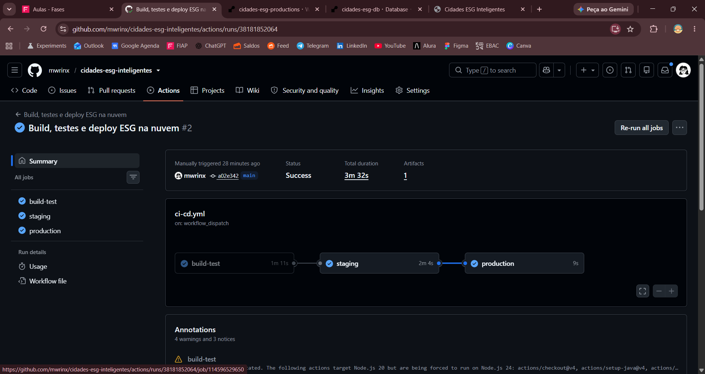
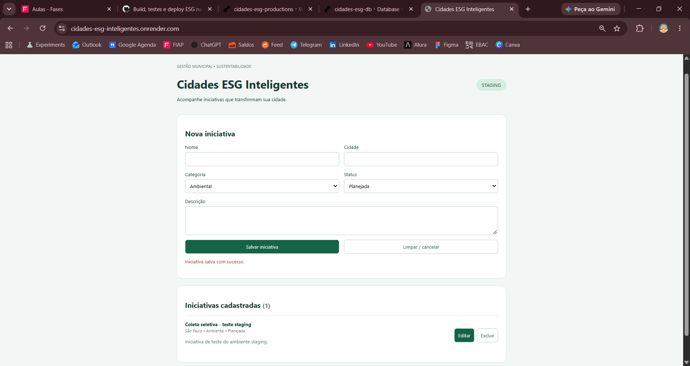
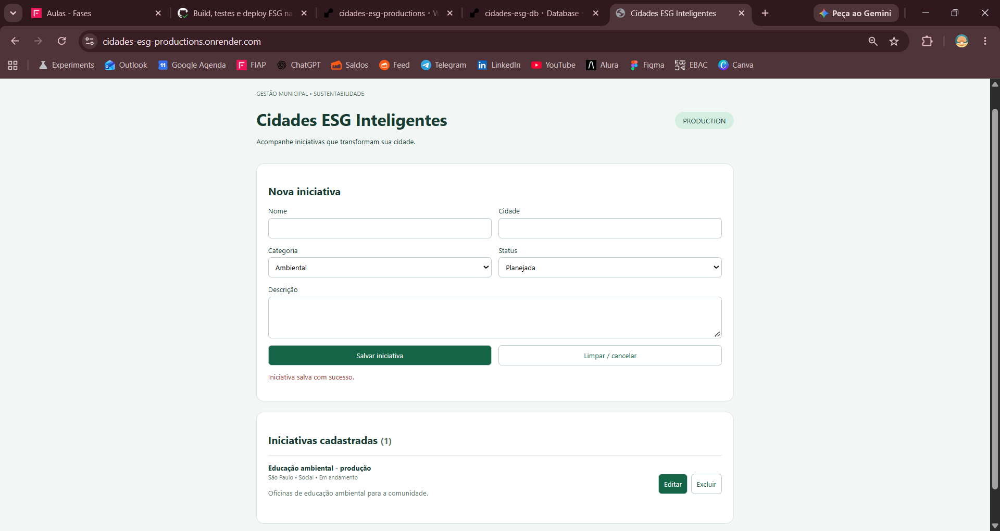

# Projeto — Cidades ESG Inteligentes

**Marina Espirito Santo Lopes — RM 558200**

Aplicação acadêmica ESG criada para este desafio: cadastro, consulta, edição e exclusão de iniciativas municipais ambientais, sociais e de governança. Campos: nome, cidade, descrição, categoria e status. O projeto demonstra CI/CD, testes, containerização e deploy em dois ambientes de demonstração na nuvem.

## Como executar localmente com Docker

Pré-requisito: Docker Desktop iniciado com contêineres Linux. Abra o PowerShell na pasta do projeto:

```powershell
Copy-Item .env.example .env
# Edite DB_PASSWORD no .env antes de continuar.
docker compose up -d --build --wait --wait-timeout 180
docker compose ps
```

Acesse http://localhost:8080. Para encerrar sem apagar registros, execute `docker compose down`. O volume preserva os dados; `down -v` remove o volume e seus registros. Persistência após recriar os contêineres foi validada localmente pela autora em 11/10/2026.

### Testes automatizados

```powershell
docker run --rm -v "${PWD}:/project" -w /project maven:3.9.9-eclipse-temurin-21 mvn -B verify
```

Oito testes de integração: CRUD e persistência, nome vazio, categoria inválida, campos ausentes, atualização e exclusão de registro inexistente, identificação do ambiente e healthcheck. Relatório local: **8 executados, 0 falhas, 0 erros, 0 ignorados**. H2 é usado somente nos testes; Docker e Render usam PostgreSQL.

## Pipeline CI/CD

GitHub Actions: `.github/workflows/ci-cd.yml`. Disparado por push em `main` ou `workflow_dispatch`. Todos os jobs executam em runners Ubuntu do GitHub; não há runner local.

1. **Build e testes**: Java 21, `mvn compile`, `mvn verify` e relatórios JUnit como artifact. Docker build valida o Dockerfile.
2. **Staging**: `scripts/render_deploy.py` envia POST ao deploy hook do Render com `ref` igual ao SHA do commit. Render reconstrói a imagem a partir do Dockerfile.
3. **Verificação**: aguarda até 25 minutos e exige ambiente correto, versão igual ao SHA, saúde `UP` e resposta da API de iniciativas.
4. **Produção**: depende de staging e repete o deploy e as verificações para o mesmo commit.

Falhas interrompem os jobs dependentes. Concurrency impede execuções simultâneas deste pipeline. Os ambientes constroem imagens separadamente a partir do mesmo commit; não se promove um único digest entre eles. Não há rollback automático.

### Configuração no Render

Dois Web Services Docker, branch `main`, plano Free e mesma região do PostgreSQL. Auto-Deploy **Off**, healthcheck `/actuator/health`. PORT e RENDER_GIT_COMMIT são fornecidos pelo Render. Não definir APP_VERSION manualmente na nuvem.

| Variável | Staging | Produção |
|---|---|---|
| APP_ENV | staging | production |
| DB_SCHEMA | staging | production |
| DB_URL | jdbc:postgresql://HOSTNAME:5432/NOME_REAL_DO_BANCO | Mesmo endereço |
| DB_USER | Username real do banco | Mesmo usuário |
| DB_PASSWORD | Senha real do banco | Mesma senha |

Hostname, Database, Username e Password devem ser copiados de Connections no Render. Não usar o nome do serviço como se fosse o nome do banco. Credenciais são configuradas no painel, nunca no código.

Os ambientes usam **schemas diferentes no mesmo banco PostgreSQL**, para respeitar o limite de um banco Free. É separação lógica de tabelas, não isolamento de credenciais, servidores ou permissões. A conexão cria o schema configurado e Hibernate utiliza esse schema. Para uso real, separar bancos, usuários e permissões.

### Configuração no GitHub

Em Settings → Environments, crie `staging` e `production`. Em cada um configure:

- Secret `RENDER_DEPLOY_HOOK`: hook do serviço correspondente, disponível em Render → Settings.
- Variable `APP_URL`: URL pública do serviço correspondente, sem barra final.

DB_PASSWORD permanece no Render; secrets DB_PASSWORD criados inicialmente no GitHub não são utilizados pelo pipeline atual. Tokens e hooks não devem ser incluídos na entrega.

## Containerização


Dockerfile em duas etapas: Maven/JDK 21 compila o JAR; JRE 21 executa com usuário sem privilégios. O build da imagem pula testes porque eles já são exigidos no job anterior; a validação local deve executar `mvn verify` antes de construir a imagem.

```dockerfile
FROM maven:3.9.9-eclipse-temurin-21 AS build
WORKDIR /build
COPY pom.xml .
RUN mvn -B dependency:go-offline
COPY src ./src
RUN mvn -B package -DskipTests

FROM eclipse-temurin:21-jre-jammy
RUN apt-get update && apt-get install -y --no-install-recommends curl && rm -rf /var/lib/apt/lists/* && useradd --system --uid 10001 app
WORKDIR /app
COPY --from=build --chown=app:app /build/target/app.jar app.jar
USER app
EXPOSE 8080
HEALTHCHECK --interval=15s --timeout=5s --start-period=60s --retries=6 CMD curl -fsS http://localhost:8080/actuator/health || exit 1
ENTRYPOINT ["java","-XX:MaxRAMPercentage=70","-jar","app.jar"]
```

Compose orquestra `app` e `db`. Rede bridge e volume nomeado são isolados por projeto Compose. O banco não publica portas no host. Variáveis de ambiente configuram conexão, senha, ambiente e versão. O healthcheck do PostgreSQL condiciona a inicialização da aplicação. Hibernate `update` simplifica o esquema deste exercício; uma implantação real precisaria de migrações versionadas, autenticação, TLS, backups e gestão de segredos apropriada.


Na nuvem, a aplicação recebe `server.port` pela variável PORT. A orquestração Docker Compose é usada e validada localmente; na nuvem o Render gerencia os dois serviços e o banco.

## Prints do funcionamento

Execução do pipeline com **Success** em 11/10/2026; duração exibida: 3 min 32 s.

- [Execução GitHub Actions](https://github.com/mwrinx/cidades-esg-inteligentes/actions/runs/38181852064)
- [Staging](https://cidades-esg-inteligentes.onrender.com/)
- [Produção](https://cidades-esg-productions.onrender.com/)
- [Repositório](https://github.com/mwrinx/cidades-esg-inteligentes)

O repositório é privado: os links GitHub exigem autorização, mas as evidências estão no ZIP e no PDF.

### Pipeline


### Staging


### Produção


Os prints mostram um registro diferente em cada ambiente. Eles registram os estados observados; não equivalem a um teste automatizado de isolamento de permissões.

## Tecnologias utilizadas

Java 21, Spring Boot 3.5.16, Spring Web, Data JPA, Bean Validation, Actuator, PostgreSQL 16 local, PostgreSQL gerenciado pelo Render, H2, JUnit 5, MockMvc, Maven, HTML/CSS/JavaScript, Docker, Docker Compose, GitHub Actions, Python e PowerShell.

## Desafios encontrados e soluções

- Virtual Machine Platform e WSL: recurso Windows habilitado, WSL instalado e computador reiniciado.
- Runner Windows bloqueado pelo Device Guard: migração para runners hospedados no GitHub e deploy no Render, mantendo as proteções do Windows.
- Banco inexistente na URL: corrigido o nome usando o campo Database real do Render.
- Autenticação em produção: corrigidos Username e Password com os valores do banco.
- Limite de banco gratuito: schemas separados para staging e produção.
- Avisos de depreciação de versões das Actions: a execução registrada concluiu com sucesso; warnings não foram falhas de build. Atualização das Actions fica como melhoria futura.

## Limites da demonstração

Plano Free: serviços podem suspender após 15 minutos sem tráfego, com demora na primeira abertura. PostgreSQL gratuito expira 30 dias após a criação; verificar a data no painel. Esses ambientes demonstram staging/produção para a atividade, sem disponibilidade de produção comercial. A aplicação não possui login: inserir apenas dados fictícios e não sensíveis. Backups, TLS da conexão com banco, migrações versionadas e controle de acesso precisam de configuração adicional para uso real. HTTPS público é fornecido pelo Render.

## Checklist de entrega obrigatório

| Item | OK |
|---|:---:|
| Projeto compactado em ZIP com estrutura organizada | [x] |
| Dockerfile funcional | [x] |
| docker-compose.yml funcional com rede, volume e variáveis | [x] |
| Pipeline com build, testes e deploy executados | [x] |
| README com instruções e prints | [x] |
| Documentação técnica em PDF com evidências | [x] |
| Deploy realizado em staging e produção | [x] |
